# PetCare

반려동물의 일정과 건강 기록을 가족 구성원과 함께 관리하는 웹 서비스입니다.

## 프로젝트 개요

반려동물을 키우는 가정에서는 약 먹일 시간, 병원 예약, 체중 변화가 가족 메신저와 개인 메모에 흩어지기 쉽습니다. PetCare는 이 기록을 한 계정에 모으고, 초대한 가족만 같은 반려동물을 볼 수 있게 만들었습니다.

서버는 Kotlin과 Spring Boot로 작성했습니다. 화면은 Thymeleaf로 그리고, 같은 애플리케이션에 JSON API가 있습니다. 데이터는 MySQL에 저장합니다. 이후 같은 애플리케이션을 Docker 이미지로 만들고, Kubernetes에서 장애 복구와 확장을 확인했습니다.

## 주요 기능

| 기능 | 사용자가 하는 일 |
| --- | --- |
| 홈 | 오늘 할 일과 중요 일정을 먼저 확인한다 |
| 캘린더 | 월·주·일 단위로 일정을 찾고 추가한다 |
| 반려동물 | 프로필을 등록하고 일정·건강 기록으로 들어간다 |
| 가족 | 가족을 만들고 초대 코드로 구성원을 받는다 |
| 공유 | 소유한 반려동물을 가족에게 공유한다 |
| 건강 기록 | 체중, 예방접종, 병원 방문, 복용 약을 남긴다 |
| 계정 | 이름과 비밀번호를 바꾸고, 복구 코드를 다시 발급한다 |

로그인에 성공하면 회원은 홈으로, 관리자는 관리 화면으로 이동합니다. 같은 아이디로 15분 안에 5번 실패하면 15분 동안 로그인만 막습니다. 계정은 그때 지우지 않습니다.

## 주요 서비스 화면

### 1. 일반 사용자 기능 (User)

아래 이미지는 테스트 계정으로 연 화면입니다. 사진을 누르면 원본 크기로 볼 수 있습니다.

<table>
<tr>
<td width="50%" valign="top">
<a href="docs/screenshots/user/홈.png">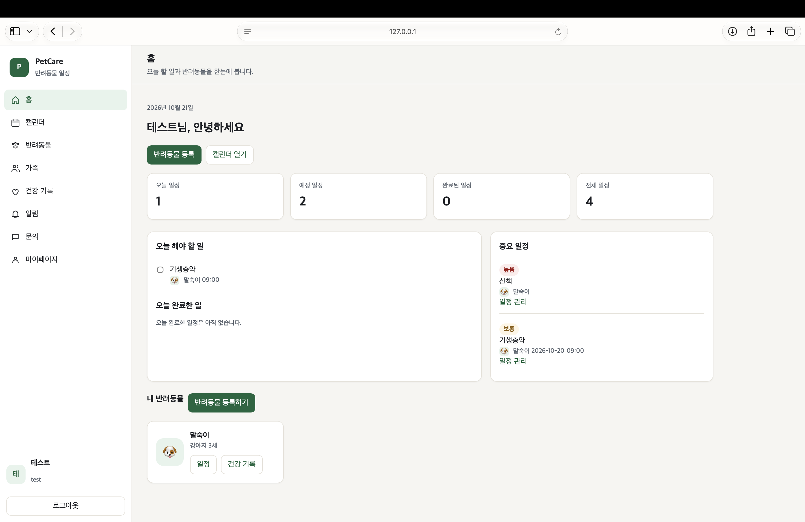</a>
<br><strong>01. 홈 대시보드</strong>
<br>오늘·예정·완료·전체 일정 수를 먼저 보여 주고, 오늘 할 일과 완료한 일, 중요 일정을 나눕니다. 아래 반려동물 카드에서 일정과 건강 기록으로 이동합니다.
</td>
<td width="50%" valign="top">
<a href="docs/screenshots/user/캘린더.png">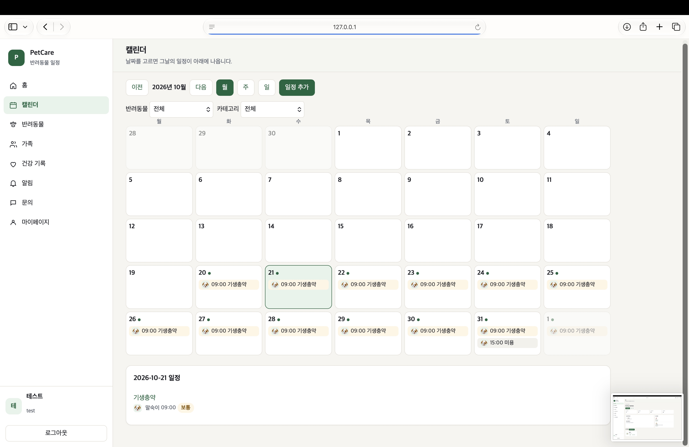</a>
<br><strong>02. 캘린더</strong>
<br>월·주·일 단위로 일정을 보고, 날짜를 누르면 그날의 일정이 나옵니다. 반려동물과 카테고리로 거르고, 일정 추가에서 없음·매일·매주·매월·평일 반복을 고릅니다.
</td>
</tr>
<tr>
<td width="50%" valign="top">
<a href="docs/screenshots/user/반려동물.png">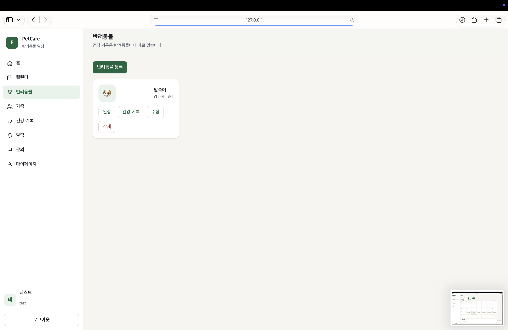</a>
<br><strong>03. 반려동물 관리</strong>
<br>이름, 종류, 나이가 보이는 카드에서 일정과 건강 기록으로 들어가고, 정보를 수정하거나 삭제합니다. 삭제는 그 반려동물의 소유자만 할 수 있습니다.
</td>
<td width="50%" valign="top">
<a href="docs/screenshots/user/가족.png">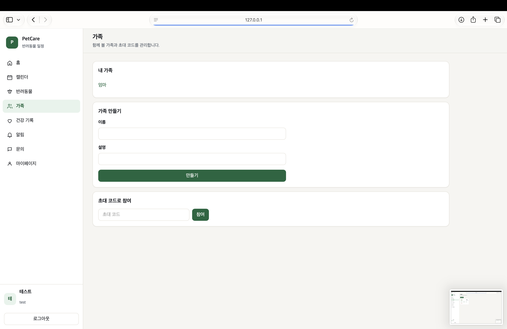</a>
<br><strong>04. 가족 관리</strong>
<br>이름과 설명으로 가족을 만들고, 이미 속한 가족 목록을 봅니다. 초대 코드를 입력해 다른 가족에 참여하며, 코드 발급은 가족 상세 화면에서 합니다.
</td>
</tr>
<tr>
<td width="50%" valign="top">
<a href="docs/screenshots/public/내%20가족%20내부.png"></a>
<br><strong>05. 가족 상세 및 공유</strong>
<br>구성원과 소유자를 구분하고, 소유자는 초대 코드를 만들어 자신의 반려동물을 공유합니다. 공유 전에는 가족이 기록을 볼 수 없고, 최근 활동에 생성과 코드 발급이 남습니다.
</td>
<td width="50%" valign="top">
<a href="docs/screenshots/user/반려동물%20관리%20등록.png"></a>
<br><strong>06. 반려동물 등록</strong>
<br>프로필은 사진, 이모지, 이름 첫 글자 중 하나입니다. 사진은 JPG·PNG·WebP, 최대 5MB이며 서버가 JPEG로 다시 저장하고, 이름·종류·나이를 등록하면 카드 목록에 추가됩니다.
</td>
</tr>
<tr>
<td width="50%" valign="top">
<a href="docs/screenshots/user/건강기록.png">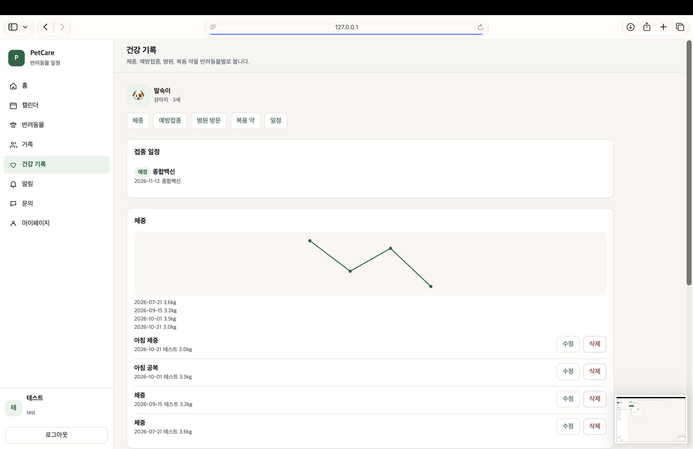</a>
<br><strong>07. 건강 기록 — 체중</strong>
<br>반려동물별 체중을 날짜 그래프로 보고, 각 기록을 수정하거나 삭제합니다. 위쪽에는 다가오는 예방접종 일정이 함께 표시됩니다.
</td>
<td width="50%" valign="top">
<a href="docs/screenshots/user/건강기록2.png">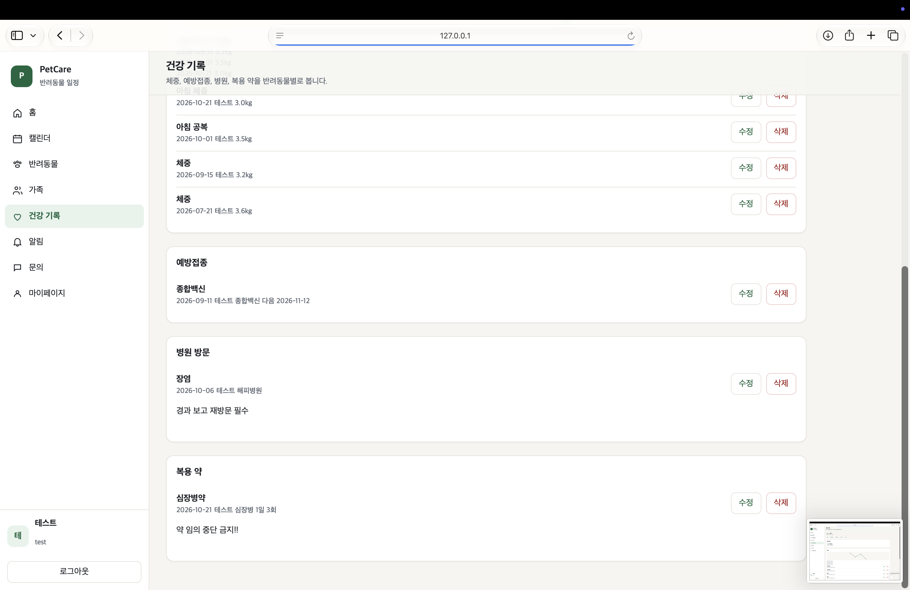</a>
<br><strong>08. 건강 기록 — 의료</strong>
<br>예방접종, 병원 방문, 복용 약을 나눠 기록합니다. 접종은 다음 예정일, 병원은 진단과 메모, 약은 복용 메모를 남기고, 각 항목을 수정하거나 삭제합니다.
</td>
</tr>
<tr>
<td width="50%" valign="top">
<a href="docs/screenshots/user/마이페이지.png">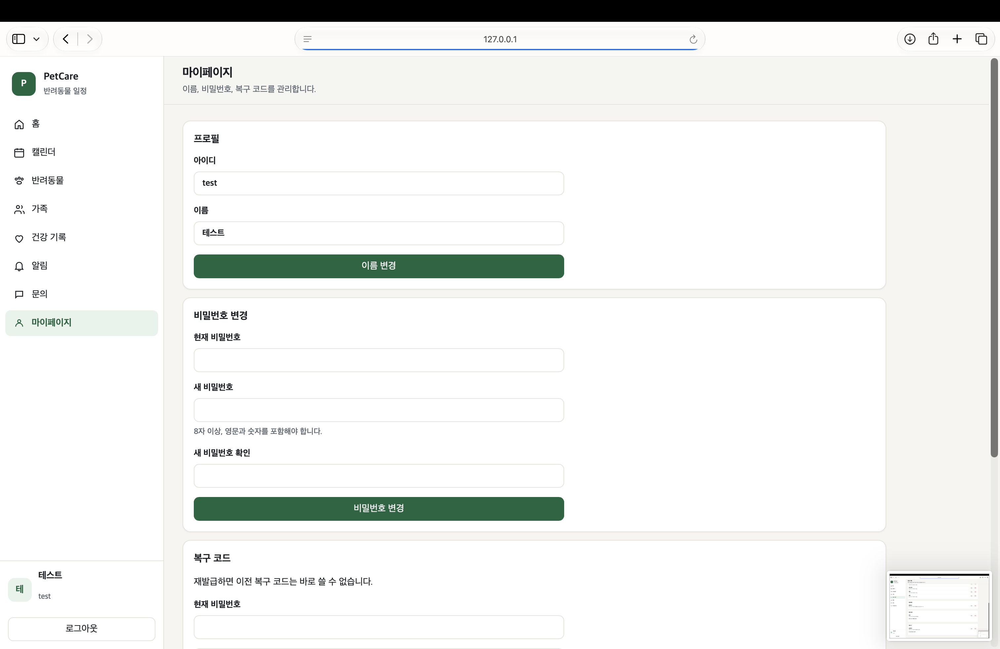</a>
<br><strong>09. 마이페이지 — 계정</strong>
<br>아이디는 바꾸지 않고 표시 이름만 수정합니다. 비밀번호는 현재 비밀번호를 확인한 뒤, 영문과 숫자를 포함한 8자 이상으로 저장합니다.
</td>
<td width="50%" valign="top">
<a href="docs/screenshots/user/마이페이지%20탈퇴.png"></a>
<br><strong>10. 마이페이지 — 보안</strong>
<br>복구 코드를 다시 발급하면 이전 코드는 바로 무효가 되고, 데이터베이스에는 해시만 저장합니다. 탈퇴는 현재 비밀번호와 확인 문구가 필요하며, 내 반려동물·일정·건강 기록은 지우고 다른 가족의 기록은 유지합니다. 남은 가족의 소유자면 먼저 소유자를 정리해야 합니다.
</td>
</tr>
</table>

### 2. 관리자 기능 (Admin)

관리자 계정으로 로그인하면 `/admin`으로 이동합니다. 아래 이미지는 계정 정보를 가린 공개용 화면입니다.

<table>
<tr>
<td width="50%" valign="top">
<a href="docs/screenshots/public/admin/대시보드.png">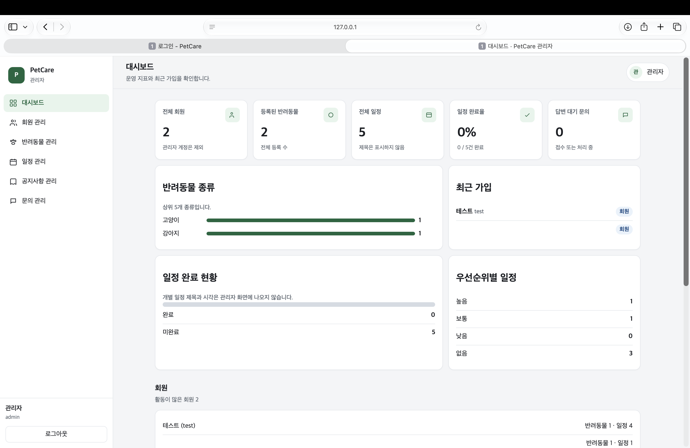</a>
<br><strong>01. 관리자 대시보드</strong>
<br>전체 회원은 관리자 계정을 빼고 세고, 반려동물 수, 전체 일정, 완료율, 답변 대기 문의를 보여 줍니다. 종류는 상위 다섯 개, 일정은 제목 없이 완료·미완료와 우선순위 건수만 집계하고, 활동이 많은 회원의 반려동물·일정 수도 나옵니다.
</td>
<td width="50%" valign="top">
<a href="docs/screenshots/public/admin/회원관리.png">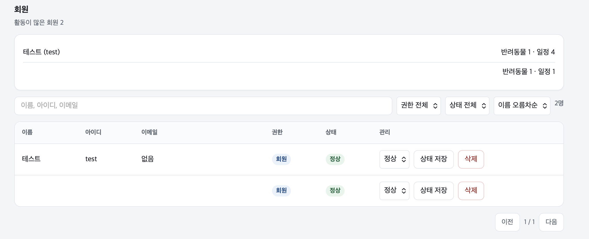</a>
<br><strong>02. 회원 관리</strong>
<br>이름, 아이디, 이메일로 찾고 상태와 정렬을 바꿉니다. 정렬은 이름 오름차순, 이름 내림차순, 최근 가입입니다. 상태는 정상 또는 정지로 저장하고, 삭제 전 확인 후 그 회원과 연결된 데이터를 지웁니다. 관리자 계정은 목록에 넣지 않습니다.
</td>
</tr>
<tr>
<td width="50%" valign="top">
<a href="docs/screenshots/public/admin/반려동물%20관리.png"></a>
<br><strong>03. 반려동물 관리</strong>
<br>전체 반려동물을 이름, 종류, 나이, 주인으로 조회합니다. 삭제하면 그 반려동물의 기록도 함께 지워지며, 관리자 화면에서 정보를 수정하는 기능은 없습니다.
</td>
<td width="50%" valign="top">
<a href="docs/screenshots/public/admin/공지사항.png">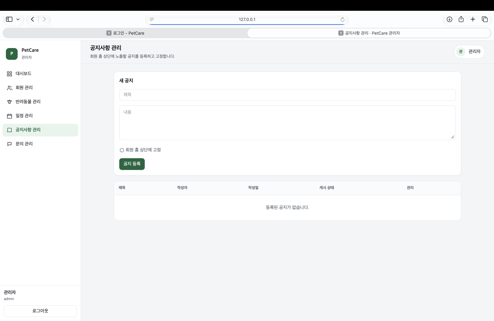</a>
<br><strong>04. 공지사항 관리</strong>
<br>제목과 내용을 등록하고, 회원 홈 상단 고정을 함께 선택할 수 있습니다. 등록된 공지는 고정하거나 해제하고 삭제할 수 있으며, 등록 후 제목이나 내용을 수정하는 기능은 없습니다.
</td>
</tr>
<tr>
<td width="50%" valign="top">
<a href="docs/screenshots/public/admin/문의관리.png">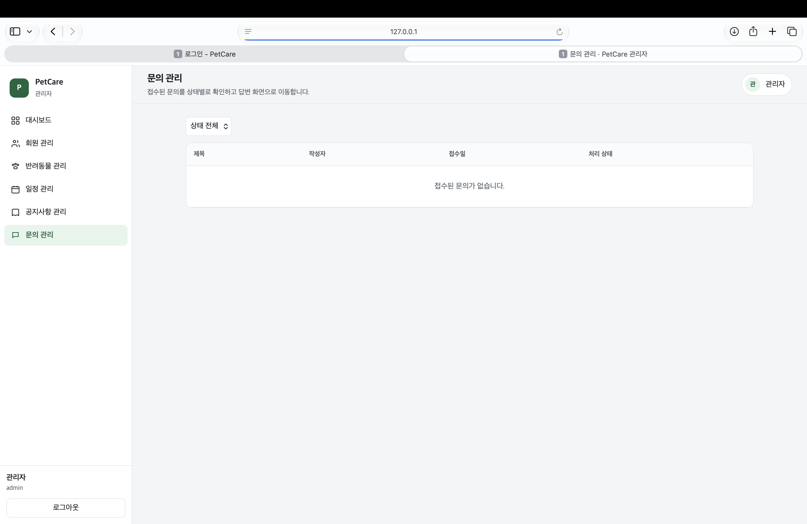</a>
<br><strong>05. 문의 관리</strong>
<br>제목, 작성자, 접수일, 처리 상태를 보고 전체·접수·처리 중·답변 완료로 거릅니다. 제목을 누르면 상태를 저장하고 답변을 등록하는 화면으로 이동합니다. 목록에서 문의를 삭제하는 기능은 없습니다.
</td>
<td width="50%" valign="top">
<a href="docs/screenshots/public/admin/공지사항%20등록.png"></a>
<br><strong>06. 등록된 공지</strong>
<br>공지를 등록하면 목록에 작성자, 작성일, 고정 여부가 표시됩니다. 고정된 공지는 고정을 해제할 수 있고, 일반 공지는 고정하거나 삭제할 수 있습니다. 등록한 제목과 내용을 수정하는 기능은 없습니다.
<br><br>
<a href="docs/screenshots/public/admin/사용자%20입장%20공지사항.png"></a>
<br><strong>사용자 홈에 보이는 공지</strong>
<br>회원 홈의 공지 영역에 같은 글이 나옵니다. 고정한 공지는 고정 표시와 함께 위에 나오고, 일반 공지는 그 아래에 제목과 내용이 표시됩니다.
</td>
</tr>
<tr>
<td width="50%" valign="top">
<a href="docs/screenshots/public/admin/사용자%20문의%20등록.png"></a>
<br><strong>07. 사용자가 등록한 문의</strong>
<br>회원이 남긴 문의는 상세 화면에서 접수 상태, 제목, 내용, 등록 시각을 보여 줍니다. 답변이 없으면 비어 있다고 안내하고, 답변이 달리면 이 화면과 알림에서 확인할 수 있습니다.
</td>
<td width="50%" valign="top">
<a href="docs/screenshots/public/admin/문의%20등록%20답변.png"></a>
<br><strong>08. 관리자 문의 답변</strong>
<br>관리자는 같은 문의의 작성자, 내용, 접수 상태를 보고 상태를 접수·처리 중·답변 완료로 저장합니다. 답변을 입력해 등록하며, 등록 전에는 아직 답변이 없다고 표시됩니다.
</td>
</tr>
</table>

## 기술 스택

| 영역 | 사용 |
| --- | --- |
| 언어 | Kotlin, Java 17 |
| 서버 | Spring Boot 4.0.1, Spring Security, Spring Data JPA |
| 화면 | Thymeleaf, HTML, CSS, JavaScript |
| 데이터베이스 | MySQL 8. 테스트는 H2 |
| 빌드 | Gradle |
| 컨테이너 | Docker, Docker Compose, Docker Hub |
| 오케스트레이션 | Kubernetes. Docker Desktop, 서버 `v1.34.1`, 노드 `linux/arm64` |
| 지표 | metrics-server `v0.9.0` |

## 시스템 아키텍처

브라우저 요청은 Spring Boot가 받습니다. 로그인 이후 화면은 Spring Security가 막고, 반려동물과 일정, 건강 기록은 Spring Data JPA로 MySQL에 저장합니다. 관리자 화면은 일반 회원과 역할이 다릅니다.

```text
브라우저
  └─ Spring Boot
       ├─ Thymeleaf 화면
       ├─ JSON API
       ├─ Spring Security
       └─ Spring Data JPA
            └─ MySQL 8
```

컨테이너로 실행할 때는 앱과 MySQL을 분리합니다. 수업용 Kubernetes에서는 앱이 `petcare-lab` 네임스페이스의 MySQL Service로만 접속합니다.

```text
petcare-lab
  petcare-service ── petcare-app Deployment
                         └─ mysql Service ── mysql Deployment
                                               └─ PVC
  petcare-lab-hpa ── petcare-app의 CPU 사용량
```

## 핵심 구현

세션 쿠키는 `HttpOnly`, `SameSite=Lax`입니다. 로컬 HTTP에서는 `Secure`를 끄고, HTTPS일 때만 켭니다. 화면을 연 채 30분 동안 사용하지 않으면 로그아웃합니다. 로그인 유지 토큰은 원문을 저장하지 않고 해시만 데이터베이스에 둡니다.

프로필 사진은 업로드 직후 이미지로 다시 열어 손상된 파일을 거르고, JPEG로 다시 인코딩합니다. 조회는 그 반려동물에 접근할 수 있는 가족까지 허용하고, 수정과 삭제는 소유자로 제한합니다.

스키마는 `ddl-auto=update`로 맞춥니다. 없는 테이블과 컬럼은 추가하고, 기존 행은 지우지 않습니다. API와 테이블 관계는 [docs/api.md](docs/api.md), [docs/erd.md](docs/erd.md)에 정리했습니다.

## Docker 및 Kubernetes 실습

애플리케이션을 이미지로 빌드한 뒤 Docker Hub 공개 저장소 [jeesyu/petcare](https://hub.docker.com/r/jeesyu/petcare)에 올렸습니다. 수업용 Compose는 앱 `8083`, MySQL `3308`로 기존 환경과 포트를 나누었습니다. Kubernetes 수업은 별도 네임스페이스 `petcare-lab`에서 진행했습니다.

| 실습 | 확인한 결과 |
| --- | --- |
| Self-healing | Pod 삭제 후 18초 만에 READY 1/1 |
| 수동 확장 | 복제본 1개에서 2개. 기존 Pod는 유지 |
| Rolling Update | `lab-v2`로 교체하는 데 37.3초 |
| HPA | CPU 50% 기준으로 2개에서 3개, 약 6분 뒤 다시 2개 |

Pod 이름, 이미지 digest, HPA 부하 조건과 metrics-server 설정은 [docs/deployment-lab.md](docs/deployment-lab.md)에 그대로 두었습니다.

## 문제 해결

수업 환경을 기존 로컬 실행과 겹치지 않게 나누는 것이 먼저였습니다. 기존 Kubernetes Service는 `8081`, 수업 Compose는 `8083`, 수업 Kubernetes는 `8084`를 사용합니다. MySQL도 기존 볼륨과 수업용 볼륨, 수업용 PVC를 서로 다른 이름으로 분리했습니다.

Rolling Update 중에는 새 Pod가 준비되기 전에 기존 Pod를 지우지 않도록 `maxUnavailable`을 낮췄습니다. 복제본 2개에서는 새 Pod를 1개 먼저 띄운 뒤 교체했습니다.

HPA는 사용량을 읽지 못하는 상태에서 시작하지 않았습니다. Docker Desktop의 kubelet 인증서에 노드 IP가 없어 metrics-server가 실패했고, 이 로컬 클러스터에서만 `--kubelet-insecure-tls`를 추가한 뒤에 부하 테스트를 진행했습니다. 통신 암호화는 유지되고, 인증서가 클러스터 CA와 주소에 맞는지만 확인하지 않습니다.

## 실행 방법

Java 17과 MySQL 8이 필요합니다. 기본 포트는 `8081`이고, 데이터베이스 이름은 `petcare`입니다.

```bash
cp .env.example .env
./gradlew bootRun
./gradlew test
```

`.env`에는 `SPRING_DATASOURCE_URL`, `SPRING_DATASOURCE_USERNAME`, `SPRING_DATASOURCE_PASSWORD`, `PETCARE_ADMIN_INITIAL_PASSWORD`를 채웁니다. 이 파일은 Git에 올리지 않습니다. 값이 비어 있으면 서버는 비밀번호를 출력하지 않고, 빠진 변수 이름만 알려 준 뒤 멈춥니다.

수업용 컨테이너는 아래 명령으로 실행합니다. `.env.lab`도 Git에 포함하지 않습니다.

```bash
docker compose --env-file .env.lab -f docker-compose.lab.yml up -d
```

Kubernetes 매니페스트는 `k8s/lab/`에 있습니다. Secret 예시의 값은 `REPLACE_ME`이며, 실제 Secret은 클러스터에만 만들었습니다.

## 기술적 한계와 개선 지점

로그인 세션은 Pod 메모리에 있습니다. Pod가 바뀌면 그 브라우저 세션은 사라집니다. `sessionAffinity: ClientIP`는 같은 컴퓨터의 요청을 한 Pod로 보내지만, 그 Pod가 교체되면 다시 로그인해야 합니다. 여러 복제본에서 세션을 유지하려면 세션 저장소를 Pod 밖으로 옮겨야 합니다.

사진 파일도 Pod 안 디스크에 있고 공유 PVC가 없습니다. Pod가 사라지면 그 사진 파일은 사라지고, 데이터베이스에는 파일 이름만 남습니다. 업로드한 사진을 유지하려면 사진 디렉터리를 공유 볼륨에 두어야 합니다.

메일 발송과 기기 푸시는 없습니다. 알림은 앱 안 목록입니다. 스키마 변경은 운영용 마이그레이션 도구 없이 `ddl-auto=update`에 의존합니다. 이 값을 `create`나 `create-drop`으로 바꾸면 기존 행이 사라질 수 있습니다.

metrics-server의 `--kubelet-insecure-tls`는 Docker Desktop에서 진행한 이번 실습에만 해당합니다. 공개된 클러스터에 그대로 적용할 설정이 아닙니다.
