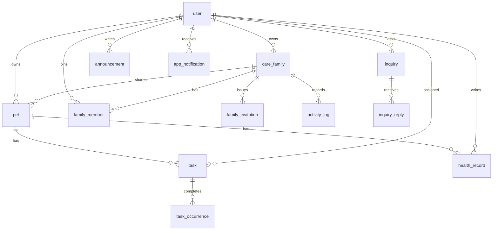

# ERD

Hibernate가 MySQL `petcare`에 맞춥니다. 예약어를 피하려고 가족 그룹 테이블 이름은 `care_family`, 알림 테이블 이름은 `app_notification`입니다.

## 테이블

| 테이블 | 핵심 컬럼 | 비고 |
| --- | --- | --- |
| `user` | username, password, name, email, role, status, version | email·role·status는 기존 행에서 비어 있을 수 있다. status가 비면 정상. version은 동시 수정 검사용이며 기존 행은 0 |
| `pet` | name, type, age, image_url, user_id, family_id, version | family_id가 없으면 개인 반려동물 |
| `care_family` | name, description, owner_id, created_at | |
| `family_member` | family_id, user_id, role | (family_id, user_id) 유일. role은 OWNER, MEMBER |
| `family_invitation` | code, status, expires_at, created_by, accepted_by | 코드는 한 번, 7일. OPEN, USED, REVOKED |
| `activity_log` | family_id, actor_id, action, summary, created_at | 최근 30건을 가족 화면에 표시 |
| `task` | title, due_date, due_time, repeat_type, weekdays, notification_time, priority, category, description, pet_id, assignee_id, done, version | 반복 일정의 done은 날짜별 기록과 별개 |
| `task_occurrence` | task_id, occurrence_date, done, completed_by, completed_at, memo | (task_id, occurrence_date) 유일 |
| `health_record` | record_type, record_date, title, description, weight, vaccination_type, hospital_name, medication_name, medication_dosage, next_due_date, author_id, created_at, pet_id, version | 기존 행의 작성자는 비어 있을 수 있다 |
| `announcement` | title, body, pinned, author_id, created_at | |
| `inquiry` | title, body, status, author_id, created_at | OPEN, IN_PROGRESS, ANSWERED |
| `inquiry_reply` | inquiry_id, body, author_id, created_at | 답변이 달리면 문의는 ANSWERED |
| `app_notification` | user_id, type, title, body, link, read_at, dedupe_key, created_at | (user_id, dedupe_key) 유일 |

`user.role`은 `USER`, `ADMIN`입니다. 가족 역할 `OWNER`, `MEMBER`와 다릅니다.
